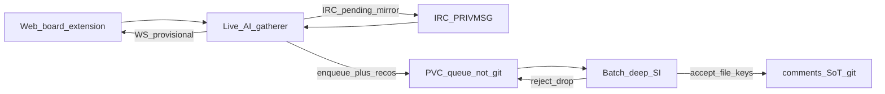

# Intake queue (queue-before-SoT)

Canonical product policy: **IRC and web comments are queued; only the batch SI permanently stores accepted posts in the comments SoT.** The live lightweight AI gathers queued bodies and recommended categorization. Spam and inappropriate posts that fail batch intake never enter git.

Related: [`infra.md`](infra.md) · [`chat-host.md`](chat-host.md) · [`irc-backbone.md`](irc-backbone.md) · [`spam.md`](spam.md) · [`AGENTS.md`](../AGENTS.md).

## One-sentence rule

> **Queue every claim as soon as it appears; permanent filing only after batch accepts — cite the live web; don’t invent standing exceptions.**

## Responsibilities

| Path | Role |
|------|------|
| **Live AI** (web `/api/chat`, extension, IRC bridge) | Gatherer: accept body + optional chosen slot, recommend categories, **enqueue**, fan out provisional UI/IRC. Does **not** create comment files or git commits on the comments branch. |
| **Queue** | Ephemeral PVC store **outside** comments git (e.g. `var/clevertree-live/queue/`). Never mesh-published. |
| **Batch deep SI** | Sole writer of `pages/…` on the comments SoT. Reads queue → quality/spam screen → file accepted posts → drop rejects → associations/fetch/spam-court on **filed** content only. |

## Queue item sketch

Per-page or global append-only records (JSON/JSONL), not git:

| Field | Meaning |
|-------|---------|
| `id` | Stable UUID for the queued post |
| `page` / `topic` | Debate room |
| `body` | Author text |
| `visitor` | Visitor UUID (IRC: UUID5 from nick) |
| `source` | `web` \| `irc` \| `extension` |
| `recommended` | Live AI suggested key slots |
| `chosen` | Optional author-chosen existing key |
| `enqueued_at` | UTC timestamp |
| `status` | `pending` \| `accepted` \| `rejected` |

## Board / IRC UX

- Board merges **SoT sections** with **provisional** queue rows (pending-batch badge).
- After batch **accept**, the post appears as an ordinary filed comment; queue row cleared.
- After batch **reject**, the provisional row disappears; **no** comment body in SoT. Optional local audit log outside git.
- IRC `PRIVMSG` uses the same enqueue path (not a SoT bypass). Mirrored announces may mark posts as pending batch.
- Owner `!answer` / `si answer:` may still fold into `owner-answers.md` / `rules.md` (rules are not comment spam).

## Spam interaction

1. **Pre-SoT (intake):** batch may reject before any comment file exists — preferred path for clear spam/abuse.
2. **Post-SoT (filed):** existing flag → contest (X) → hide → remove (Y) from [`spam.md`](spam.md) still applies to posts already in the tree.

## Non-goals (this policy doc)

- Does not require GPU; heuristic drain may act as the batch processor until a Spot GPU pass exists — same sole-writer rule.
- Does not put the queue on iad1/GitHub.
- Chrome Web Store / marketing copy stay high-level (“organized by batch SI”).

## Implementation backlog (ordered)

1. **Queue store** — `var/clevertree-live/queue/` schema + helpers; no git.
2. **Live submit rewrite** — [`live_runtime.py`](../clevertree_chat/live_runtime.py) / [`service.py`](../clevertree_chat/service.py): enqueue + provisional view; stop live `commit_changes` for new comments.
3. **View merge** — `view` / `board.snapshot` merge SoT + pending queue.
4. **IRC** — [`irc_bridge.py`](../clevertree_chat/irc_bridge.py): PRIVMSG → enqueue; pending mirror.
5. **Batch consume** — drain reads queue first; accept → file/pair/position; reject → drop; then hooks on filed content.
6. **Tests** — submit creates no SoT comment files; accept writes SoT; reject leaves SoT clean; E2E provisional → filed.
7. **Ops / UI** — PVC layout; coach copy “Pending batch review”; migrate off live-into-git (existing SoT history stays).

*Status: policy locked in docs; code cutover not yet shipped (live still writes SoT today).*
