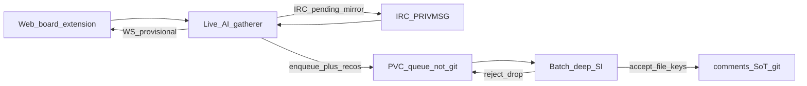

# Intake queue (queue-before-SoT)

Canonical product policy: **IRC and web comments are queued; only the batch SI permanently stores accepted posts in the comments SoT.** The live lightweight AI gathers queued bodies and recommended categorization. Spam and inappropriate posts that fail batch intake never enter git.

**Phases:** [`batch-phases.md`](batch-phases.md) · Relay SoT [`../../myproblem/docs/batch-phases.md`](../../myproblem/docs/batch-phases.md). Phase 1 batch agent = **Cursor** on the shared multi-site queue; Phase 2 = Spot. Live path must not be the end-state SoT writer.

Related: [`infra.md`](infra.md) · [`chat-host.md`](chat-host.md) · [`irc-backbone.md`](irc-backbone.md) · [`spam.md`](spam.md) · [`AGENTS.md`](../AGENTS.md).

## One-sentence rule

> **Queue every claim as soon as it appears; permanent filing only after batch accepts — cite the live web; don’t invent standing exceptions.**

## Responsibilities

| Path | Role |
|------|------|
| **Live AI** (web `/api/chat`, extension, IRC bridge) | Gatherer: accept body + optional chosen slot, recommend categories, **enqueue**, fan out provisional UI/IRC. Does **not** create comment files or git commits on the comments branch. |
| **Queue** | Ephemeral PVC store **outside** comments git (e.g. `var/clevertree-live/queue/`). Never mesh-published. |
| **Batch deep SI** | Sole writer of `pages/…` on the comments SoT. Reads queue → quality/spam screen → file accepted posts → drop rejects → associations/fetch/spam-court on **filed** content only. |



## Queue item sketch

Per-page or global append-only records (JSON/JSONL), not git:

| Field | Meaning |
|-------|---------|
| `id` | Stable UUID for the queued post |
| `page` / `topic` | Debate room |
| `body` | Author text |
| `visitor` | Visitor UUID (IRC: UUID5 from nick) |
| `source` | `web` \| `irc` \| `extension` |
| `recommended` | Live AI suggested key slots |
| `chosen` | Optional author-chosen existing key |
| `enqueued_at` | UTC timestamp |
| `status` | `pending` \| `accepted` \| `rejected` |

### IRC / WS log batches (`kind: irc_log`)

Separate from claim enqueue. Live host rotates ephemeral segments and drops a job beside the queue:

```json
{
  "site": "clevertree",
  "kind": "irc_log",
  "topic": "ga-savannah-cat-rescue",
  "channel": "#ga-savannah-cat-rescue",
  "payload_ref": "intake://irc-logs/ga-savannah-cat-rescue/seg-….jsonl",
  "enqueued_at": "…",
  "rules_ref": "comments:rules.md",
  "status": "pending"
}
```

Batch reads the segment, registers unseen visitors into `users/index.json`, and — when `chat_store` allows — appends minimized lines to `pages/<page>/chat/YYYY-MM-DD.jsonl` (`{"t","u","b"}` with short id `u`). `chat_store: never` skips transcript write; cache/job still consumed. Helpers: `clevertree_chat.irc_log_cache`, `clevertree_chat.chat_transcript`.

### Channel media ASR (`kind: channel_asr`)

MyProblem speak/video posts include `[[mp:media kind=… url=… channel=…]]`. On submit / IRC fanout the host enqueues:

```json
{
  "site": "myproblem",
  "kind": "channel_asr",
  "topic": "mp-general",
  "media_kind": "audio",
  "url": "https://…/chat-public/…",
  "enqueued_at": "…",
  "status": "pending"
}
```

Queue path: `var/clevertree-live/queue/channel_asr/`. Drain (`action=drain_channel_asr` or host tick) downloads the URL, calls Groq Whisper when `GROQ_API_KEY` is set, and posts an SI transcript line into the channel — **no tip mint**. Helpers: `clevertree_chat.channel_media`, `clevertree_chat.channel_asr`.

## Board / IRC UX

- Board merges **SoT sections** with **provisional** queue rows (pending-batch badge).
- After batch **accept**, the post appears as an ordinary filed comment; queue row cleared.
- After batch **reject**, the provisional row disappears; **no** comment body in SoT. Optional local audit log outside git.
- IRC `PRIVMSG` uses the same enqueue path (not a SoT bypass). Mirrored announces may mark posts as pending batch.
- Owner `!answer` / `si answer:` may still fold into `owner-answers.md` / `rules.md` (rules are not comment spam).

## Spam interaction

1. **Pre-SoT (intake):** batch may reject before any comment file exists — preferred path for clear spam/abuse.
2. **Post-SoT (filed):** existing flag → contest (X) → hide → remove (Y) from [`spam.md`](spam.md) still applies to posts already in the tree.

## Non-goals (this policy doc)

- Does not require GPU; heuristic drain may act as the batch processor until provider-backed Phase 2 automation exists — same sole-writer rule.
- Does not put the queue on iad1/GitHub.
- Chrome Web Store / marketing copy stay high-level (“organized by batch SI”).

## Implementation backlog (ordered)

1. **Queue store** — `var/clevertree-live/queue/` schema + helpers; no git. *(Partial: `queue/irc_log/` + `irc-logs/` cache landed; claim enqueue still pending.)*
2. **Live submit rewrite** — [`live_runtime.py`](../clevertree_chat/live_runtime.py) / [`service.py`](../clevertree_chat/service.py): enqueue + provisional view; stop live `commit_changes` for new comments.
3. **View merge** — `view` / `board.snapshot` merge SoT + pending queue.
4. **IRC** — [`irc_bridge.py`](../clevertree_chat/irc_bridge.py): PRIVMSG → enqueue; pending mirror. *(Ephemeral log cache + `irc_log` jobs live; claim path still transitional submit.)*
5. **Batch consume** — drain reads queue first; accept → file/pair/position; reject → drop; then hooks on filed content. *(IRC transcripts: `drain_irc_logs` / `chat_transcript.accept_irc_log_job`.)*
6. **Tests** — submit creates no SoT comment files; accept writes SoT; reject leaves SoT clean; E2E provisional → filed.
7. **Ops / UI** — PVC layout; coach copy “Pending batch review”; migrate off live-into-git (existing SoT history stays).

*Status: policy locked; **Phase 1 target** = enqueue + Cursor drain (sole SoT writer). Transitional: live may still write SoT until cutover — treat that as historical debt, not the end state ([`batch-phases.md`](batch-phases.md)).*
